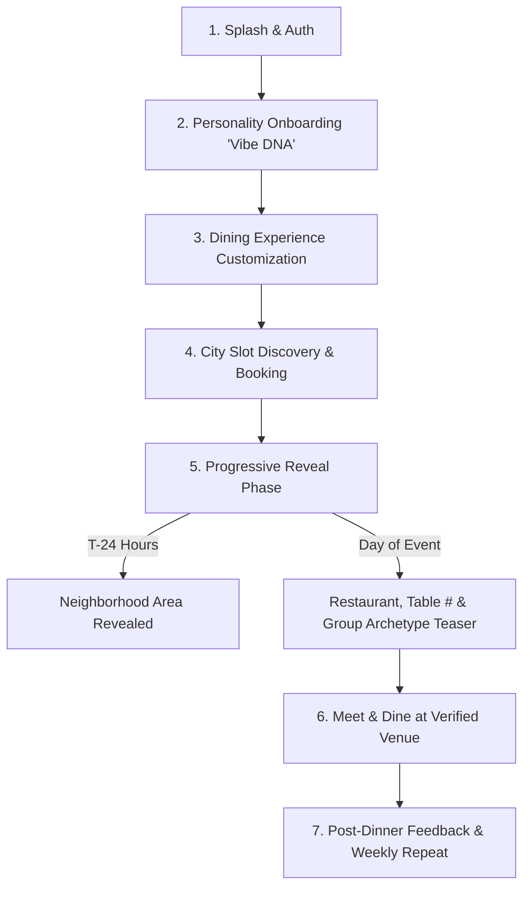
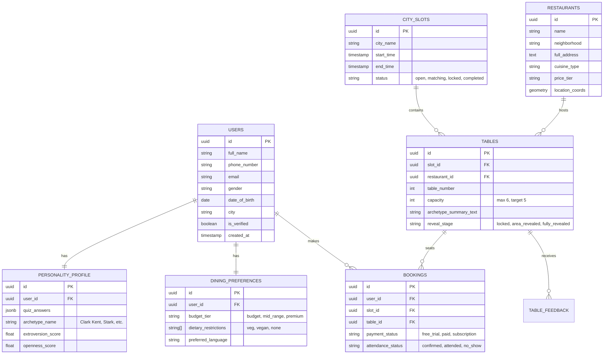

# Kalisi — Product Requirements & Technical Specification Document

**Project Name:** Kalisi  
**Reference Benchmark:** Together: Dinners That Connect (`com.gautham2981.togetherfrontend`)  
**Core Concept:** Curated 5-Stranger Offline Social Meetups & Dinners Matched by Personality DNA  
**Document Version:** 2.0.0  
**Target Platforms:** iOS & Android (Cross-Platform Mobile App) + Admin Management Portal  

---

## 1. Executive Summary & Value Proposition

### 1.1 The Concept
**Kalisi** is a social connection platform designed around the principle:  
> **"Five Strangers, One Unforgettable Meal."**

Unlike traditional dating apps (high-pressure 1-on-1 swiping) or meetup groups (overwhelming 30+ person crowds), Kalisi connects small, hand-picked groups of **4 to 6 people (ideal target: 5 strangers)** for offline curated dinners every weekend at verified restaurants.

### 1.2 Core Pillars
1. **Dinner-First, Profile-Later:** Users connect over real-time physical presence, not static photos or resume-style bios.
2. **The "Vibe DNA" & Personality Matchmaking:** Proprietary onboarding questionnaire categorizes users into conversational archetypes (e.g., *The Charismatic Leader*, *The Deep Listener*, *The Creative Thinker*) to ensure optimal table chemistry.
3. **The Progressive Reveal Experience:**
   * **Booking:** Select city and preferred weekend time slot.
   * **T - 24 Hours:** General neighborhood / restaurant area revealed so guests can plan travel.
   * **Day of Event:** Full restaurant name, address, assigned table number, and group character teaser revealed (e.g., *"A mix of 3 Clark Kents, 2 Starks, and 1 Phoebe"*).
4. **Zero Pressure & Solo Attendance:** Everyone arrives solo. Pre-set tables, shared dining preferences, and conversation prompts eliminate social awkwardness.

---

## 2. User Journey & Experience Flow



---

## 3. Screen-by-Screen UI & Functional Specification

### Screen 1: Welcome & Landing Screen
* **Visual Theme:** Premium dark mode (`#121212` background) with warm accent colors (Gold `#F5A623` and Crimson `#D32F2F`).
* **UI Components**:
  * Brand Header: **Kalisi** logo.
  * Hero Image: High-energy group of friends/strangers dining together.
  * Tagline Badge: `CONNECT • DINE • EXPERIENCE`
  * Value Headline: *"Five Strangers, One Unforgettable Meal"*
  * Primary Action: **`Get started`** (high-contrast pill button).
  * Secondary Action: **`I already have an account`** (subtle ghost button).

---

### Screen 2: Personality Onboarding ("Vibe DNA")
* **Purpose:** Determine conversational style, icebreaking tendencies, and social energy.
* **UI Components**:
  * Step progress indicator bar (e.g., Question 1 of 5).
  * Prominent question headline with highlighted keywords:  
    *Example:* *"How do you usually **break the ice** in a room full of strangers?"*
  * Glow-highlighted selection pill buttons:
    * `Humor`
    * `Observation`
    * `Listening`
    * `Asking questions`
* **Output:** Algorithmic assignment into a conversational character archetype:
  * **"Clark Kent"** (The Grounded Listener / Warm & Observant)
  * **"Stark"** (The Charismatic Spark / Quick Wit & Energy)
  * **"Phoebe"** (The Creative Storyteller / Free-spirited & Empathetic)
  * **"Sherlock"** (The Curious Inquirer / Deep Thinker & Question Asker)

---

### Screen 3: Dining Experience Customization (3-Step Setup)
Configures comfort boundaries, culinary preferences, and spending levels.

```
┌────────────────────────────────────────────────────────┐
│  Step 1: Dietary & Language                            │
│  - Dietary: No restrictions, Veg, Vegan, Jain, Halal   │
│  - Preferred Language: English, Regional, etc.         │
├────────────────────────────────────────────────────────┤
│  Step 2: Budget Range Tier (Required)                  │
│  - [ ] Budget-Friendly  (Under ₹800 / $15 per person)   │
│  - [ ] Mid-Range        (₹800 - ₹1,500 per person)     │
│  - [x] Premium          (Above ₹1,500 per person)      │
├────────────────────────────────────────────────────────┤
│  Step 3: Review & Confirm Preferences                  │
│  - Summary card of preferences                         │
│  - CTA: "Confirm & Continue"                           │
└────────────────────────────────────────────────────────┘
```

---

### Screen 4: City Slot Discovery & Booking ("Events in Your City")
* **UI Components**:
  * Header Greeting: *"Hey [User Name]! Ready to Hang Out??"*
  * City Selector: Location pill (e.g., `📍 Chennai`, `📍 Bangalore`, `📍 Mumbai`).
  * Subheader: *"Events in your city — X events available"*.
  * Weekend Slot Cards:
    * Card States:
      * `Available` (Interactive, selectable card).
      * `Selected` (Highlighted with glowing border).
      * `Already Booked` (Disabled / tagged).
      * `Full / Waitlist`.
    * Card Details: Day, Date, Time Window (e.g., `Sat, 11/18/2026 • 19:00 - 22:00`).
  * Floating CTA: **`Book my seat`** (Prominent Yellow Pill Button).
  * First-Timer Hook: *"Your first dinner booking is free — try it before subscribing!"*

---

### Screen 5: Progressive Reveal & Event Details Screen
The hallmark feature that builds anticipation while protecting user privacy and preventing flakiness.

#### State A: Immediately After Booking (T > 24 Hours)
* Slot confirmed banner with animated countdown timer.
* Tip: *"We are hand-picking your dinner group. Check back 24 hours before dinner for your neighborhood reveal!"*

#### State B: T - 24 Hours (The Area Teaser)
* Neighborhood / District revealed (e.g., *"Your dinner will be in Anna Nagar / Indiranagar"*).
* Allows attendees to plan travel without revealing the exact restaurant yet.

#### State C: Day of Event (The Full Reveal)
* **Table Information Card**: `Table Number: 1`
* **Date & Time Card**: `Saturday • 19:00 - 22:00`
* **Verified Restaurant Card**:
  * Venue Name (e.g., *"Chamber of Potions"*).
  * Complete Street Address with one-tap *"Open in Maps"* button.
  * Cuisine Style (e.g., *"Italian / Continental"*).
* **Group Archetype Summary Card**:
  * *"A mix of Clark Kent (3), Stark (2), and Phoebe (1)"*
  * Interactive Button: **`+ View Character Insights`** (Explains the group's conversational vibe and provides icebreaker prompt cards for the table).

---

### Screen 6: Notifications & Reminders
* Notification drawer tracking:
  * `Account creation Successful!`
  * `Your dining preferences have been saved.`
  * `Dinner match found! Area reveal is live.`
  * `Table #1 is waiting for you tonight!`

---

### Screen 7: Post-Dinner Wrap-Up & Repeat
* **Attendance Check:** Confirms physical presence at the table.
* **Private Table Chemistry Feedback:**
  * Rate table vibe (1–5 stars).
  * Food & Venue rating.
  * Positive peer accolades (*"Great conversationalist"*, *"Made everyone feel included"*).
* **The "Repeat" Loop**: *"Same energy, new faces next weekend — Book next week's slot now."*

---

## 4. Matchmaking Algorithm & Table Composition

Each table strictly seats **4 to 6 people (Target: 5 attendees)**.

### Matchmaking Criteria Weights:
1. **Budget Tier Alignment (Mandatory - 100% match):** All 5 attendees at a table must belong to the exact same budget tier (e.g., all Mid-Range) so bill splitting is seamless and friction-free.
2. **Dietary Compatibility (High priority):** Ensure restaurant choice caters to the dietary constraints of all 5 members (e.g., pure vegetarian options available if a member requires it).
3. **Conversational Archetype Chemistry (Algorithmic Balance):**
   * Avoid monocultures (e.g., never pair 5 quiet listeners together, nor 5 dominant talkers).
   * **Ideal Table Recipe:**
     * 2 Enthusiastic / Storytellers (*Stark / Phoebe*)
     * 2 Grounded / Empathetic Listeners (*Clark Kent*)
     * 1 Curious / Question Asker (*Sherlock*)
4. **Age Proximity:** Group members within compatible age cohorts ($\pm 4$ years).
5. **No Repeats:** Attendees who previously met at a Kalisi table are not matched together again for at least 90 days.

---

## 5. Technical Architecture & System Design

```
┌────────────────────────────────────────────────────────────────────────┐
│                        Client Mobile Application                       │
│  Flutter / React Native (iOS & Android)                                │
│  - Dark UI Theme (Theme tokens: Gold, Crimson, Charcoal)               │
│  - Multi-step Question Engine & Customization Modals                   │
│  - Progressive Reveal Engine & Interactive Maps Integration            │
└──────────────────────────────────┬─────────────────────────────────────┘
                                   │ HTTPS / REST & WSS
┌──────────────────────────────────▼─────────────────────────────────────┐
│                          API Gateway Layer                             │
│  Rate Limiting, Reverse Proxy, JWT Authentication, SSL Termination     │
└──────────────────────────────────┬─────────────────────────────────────┘
                   ┌───────────────┴───────────────┐
                   ▼                               ▼
┌──────────────────────────────────────┐  ┌──────────────────────────────┐
│         Core Backend Services        │  │     Background Job Worker    │
│         (Node.js / Go)               │  │  (BullMQ / Celery + Redis)   │
│  - Onboarding & Vibe DNA Engine      │  │  - T-24h Area Reveal Trigger │
│  - City Slot Inventory & Booking     │  │  - Day-of Venue Full Reveal  │
│  - Matchmaking Clustering Worker     │  │  - Table Assignment Engine   │
│  - Payments & Subscription Engine    │  │  - Push Reminder Dispatch    │
└──────────────────┬───────────────────┘  └──────────────┬───────────────┘
                   │                                     │
┌──────────────────▼─────────────────────────────────────▼───────────────┐
│                           Data & Storage Layer                         │
│  - PostgreSQL + PostGIS: Users, Profiles, Slots, Venues, Tables        │
│  - Redis: In-memory slot reservation locks, countdowns, session cache  │
│  - AWS S3 / Cloudflare R2: Venue photography, curated media            │
└────────────────────────────────────────────────────────────────────────┘
```

### 5.1 Recommended Tech Stack
| Component | Technology | Rationale |
|---|---|---|
| **Mobile App** | **Flutter** or **React Native (Expo)** | Pixel-perfect implementation of dark theme, custom modals, and smooth animations. |
| **Backend API** | **Node.js (NestJS / TypeScript)** or **Go** | Modular architecture, strong typing, clean separation of services. |
| **Database** | **PostgreSQL + PostGIS** | Relational integrity for bookings and tables; PostGIS for city and restaurant geocoding. |
| **Queue / Scheduler** | **BullMQ + Redis** | Crucial for progressive reveal timelines ($T-24\text{h}$, Day-of) and table locking. |
| **Maps & Venues** | **Google Places API** | Venue details, cuisine classification, and directions. |
| **Push Notifications**| **Firebase Cloud Messaging (FCM)** | Timely reveal announcements and dinner day reminders. |
| **Payments** | **Razorpay / Stripe** | Ticket bookings, membership plans, and corporate dinner passes. |

---

## 6. Database Entity-Relationship Model (PostgreSQL)



---

## 7. Development Roadmap & Milestones

### Phase 1: MVP Core (Weeks 1–4)
* [ ] Phone Auth (OTP) & basic user registration.
* [ ] Onboarding "Vibe DNA" quiz engine with Archetype classification.
* [ ] 3-Step Dining Preferences customization (Budget tier, Dietary, Language).
* [ ] City slot listing and seat reservation UI with free-trial booking logic.
* [ ] Admin portal for manually creating city weekend slots and entering restaurant details.

### Phase 2: Matchmaking & Progressive Reveal Engine (Weeks 5–7)
* [ ] Automated Matchmaking Worker (clustering 4–6 compatible users per table based on budget, dietary, and archetype balance).
* [ ] Automated Progressive Reveal state machine ($T-24\text{h}$ Area Teaser $\to$ Day-of Venue & Table # Reveal).
* [ ] Push Notification triggers for each reveal milestone.
* [ ] Interactive "+ View Character Insights" modal for table guests.

### Phase 3: Monetization & Safety (Weeks 8–10)
* [ ] Payment gateway integration for per-dinner passes and monthly subscription memberships.
* [ ] Post-dinner private feedback rating and attendance tracking.
* [ ] Restaurant partner dashboard for reservations and table management.

---

*This document serves as the complete technical, product, and architectural specification for **Kalisi**, built upon the proven mechanics of Together: Dinners That Connect.*
